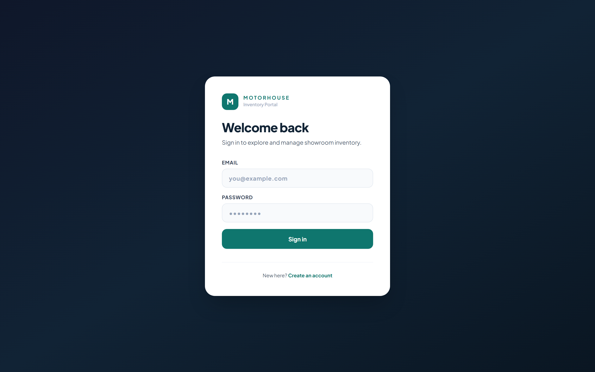
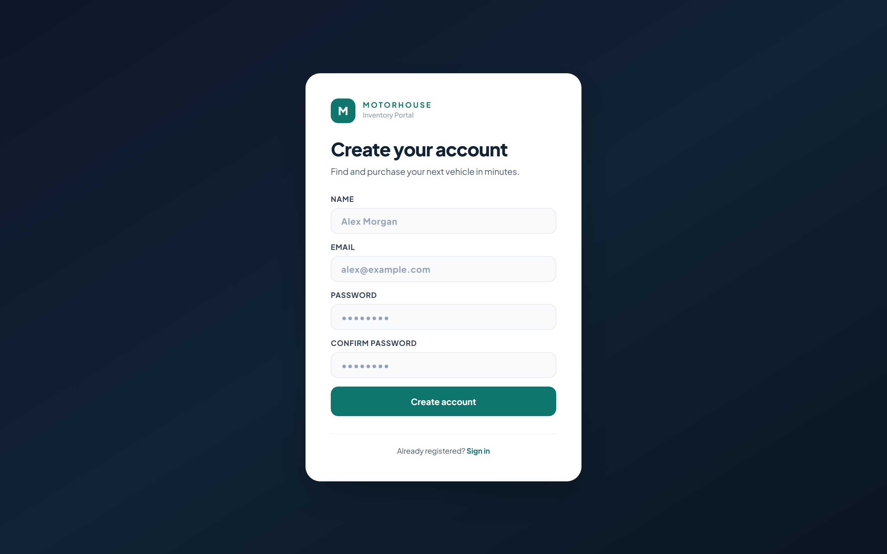
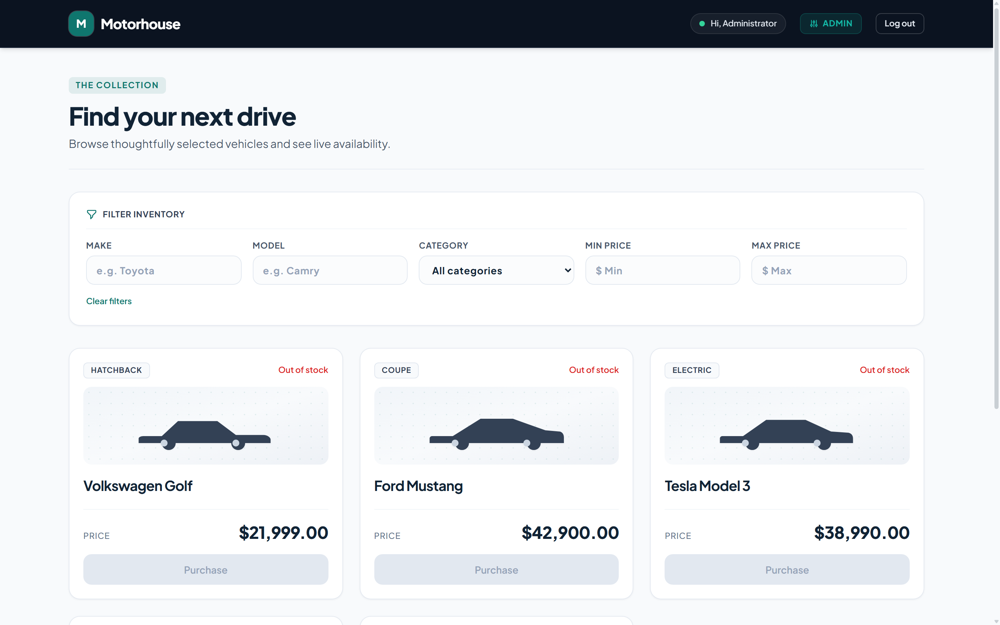
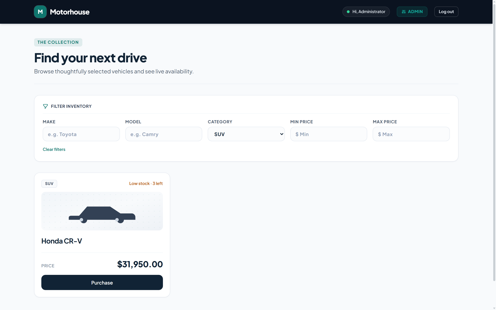
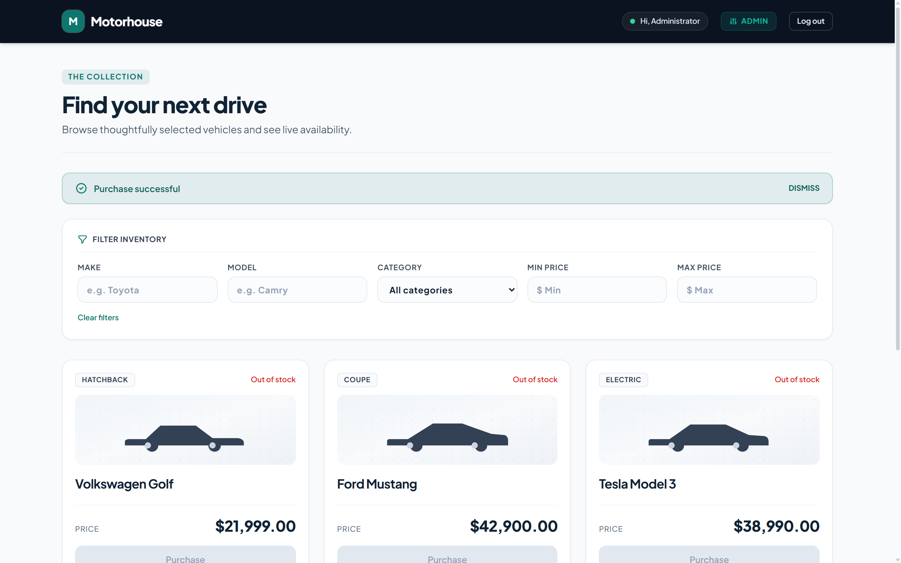
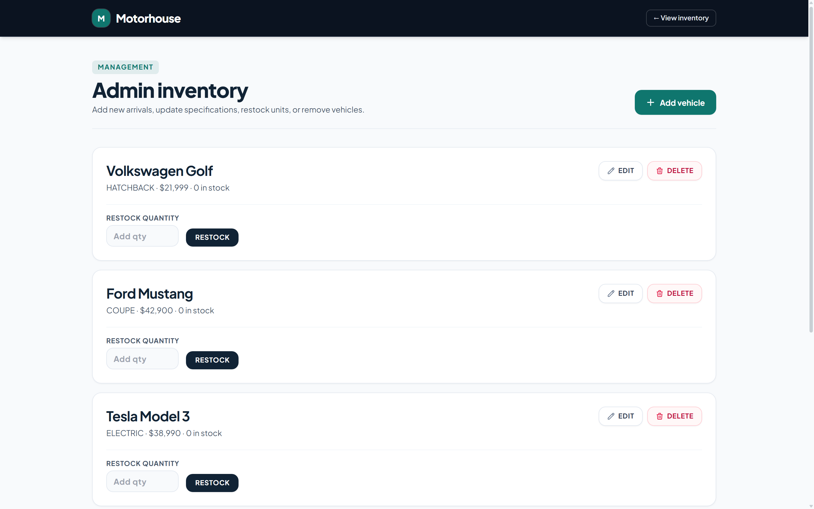
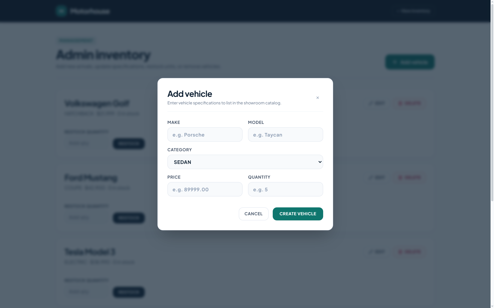
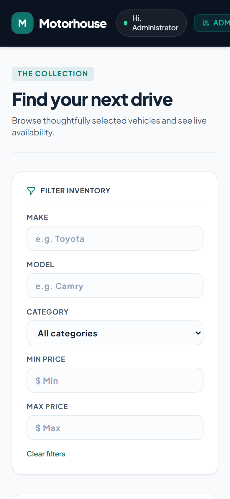

# Car Dealership Inventory System

A full stack inventory application for dealership staff and shoppers. Users can register, search a live vehicle catalog, and purchase available stock. Admins can add, edit, delete, and restock vehicles. The API persists data in SQLite and prevents simultaneous purchases from overselling the final unit.

**Repository:** https://github.com/deeptanshu584/car-dealership-inventory  
**Live demo:** Not deployed (local execution).

## Screenshots

### Customer Portal & Authentication

#### User Sign In


#### New User Registration


### Showroom Inventory & Purchasing

#### Live Vehicle Inventory Dashboard


#### Real-Time Vehicle Search and Filtering


#### Vehicle Purchase Interaction and Live Feedback


### Administrator Management Console

#### Vehicle Inventory Management & Restock Controls


#### Add Vehicle Specification Modal


### Responsive Experience

#### Mobile Viewport (390 × 844)


## Tech stack

| Area | Choice | Why |
| --- | --- | --- |
| Backend | Node.js 20+, TypeScript strict, Express 4 | Small, clear HTTP layer |
| Database | SQLite file with Prisma migrations | Persistent storage with simple local setup |
| Validation and auth | Zod, bcryptjs, JWT | Typed requests, hashed passwords, signed one-hour sessions |
| Backend tests | Jest, ts-jest, Supertest | Service and real SQLite integration tests |
| Frontend | React 18, Vite, TypeScript, React Router 6 | Responsive single-page interface |
| Styling | HTML5, CSS3, Tailwind CSS 3.4 | Mobile-first utility styling |
| Frontend tests | Vitest, React Testing Library, user-event, MSW | Component test toolchain and mocked API tests |
| Quality | ESLint and Prettier | Consistent, checked source |

Versions are pinned in each package lockfile.

## Architecture

```text
HTTP request -> route -> auth/role/validation middleware -> controller -> service
                                                        -> repository interface
                                                        -> Prisma repository -> SQLite
```

Routes map URLs. Controllers translate HTTP requests and responses. Services contain registration, stock, and other business rules. Repositories alone access Prisma. `backend/src/container.ts` wires concrete repositories to services. The React app uses `AuthContext` for the session and an API client that attaches the bearer token.

The design follows SOLID: services and repositories have separate responsibilities (S); search criteria can grow without changing the service contract (O); fake and Prisma repositories implement the same small interfaces (L and I); services receive those interfaces through constructors (D). Key folders are `backend/src/{routes,controllers,services,repositories,middleware,schemas}`, `backend/prisma`, and `frontend/src/{api,context,components,pages}`.

## Getting started

### Prerequisites

Node.js 20 or newer, npm 10 or newer, and Git. Repository: https://github.com/deeptanshu584/car-dealership-inventory.

### 1. Backend

From the project root:

```bash
cd backend
npm ci
cp .env.example .env
# Edit .env: set a long JWT_SECRET and your ADMIN_EMAIL/ADMIN_PASSWORD.
npm run db:migrate
npm run seed
npm run dev
```

On PowerShell, use `Copy-Item .env.example .env` in place of `cp`. The backend listens at `http://localhost:4000`. `npm run db:migrate` creates the SQLite file if needed and applies committed Prisma migrations. `npm run seed` creates the configured admin and five sample vehicles only when the inventory is empty. You can run both commands again safely.

### 2. Frontend

In another terminal:

```bash
cd frontend
npm ci
cp .env.example .env
npm run dev
```

The frontend opens at `http://localhost:5173`. On PowerShell, use `Copy-Item .env.example .env`. The default `VITE_API_URL` already points to the local backend.

### 3. Try it

Register a normal user, or log in as the admin using the credentials you put in `backend/.env`. Users can view stock, filter the catalog, and purchase a vehicle. Admins also have an Admin link for inventory management.

## Environment variables

| Package | Variable | Purpose | Example |
| --- | --- | --- | --- |
| Backend | `DATABASE_URL` | SQLite file, relative to `backend/prisma` | `file:./dev.db` |
| Backend | `JWT_SECRET` | JWT signing key; required | Long random string |
| Backend | `ADMIN_EMAIL` | Seeded admin email | `admin@example.com` |
| Backend | `ADMIN_PASSWORD` | Seeded admin password | Strong unique password |
| Backend | `PORT` | API port | `4000` |
| Backend | `CORS_ORIGIN` | Allowed frontend origin | `http://localhost:5173` |
| Frontend | `VITE_API_URL` | API base URL | `http://localhost:4000/api` |

Never commit either `.env` file. The repository ignores env, database, build, coverage, and dependency output.

## API reference

All routes are prefixed with `/api`. Request and success examples, query rules, and error shapes are in [docs/API.md](docs/API.md).

| Method | Path | Access | Success |
| --- | --- | --- | --- |
| GET | `/health` | Public | 200 status |
| POST | `/auth/register` | Public | 201 token and user |
| POST | `/auth/login` | Public | 200 token and user |
| POST | `/vehicles` | Authenticated | 201 vehicle |
| GET | `/vehicles` | Authenticated | 200 paginated list |
| GET | `/vehicles/search` | Authenticated | 200 filtered list |
| PUT | `/vehicles/:id` | Authenticated | 200 vehicle |
| DELETE | `/vehicles/:id` | ADMIN | 204 |
| POST | `/vehicles/:id/purchase` | Authenticated | 200 vehicle |
| POST | `/vehicles/:id/restock` | ADMIN | 200 vehicle |

## Running the tests

```bash
cd backend && npm test -- --coverage
cd frontend && npm test -- --coverage
```

ESLint and Prettier checks are `npm run lint` and `npm run format` in each package. Production builds use `npm run build`.

## Test report

The real terminal output is in [docs/test-report.md](docs/test-report.md). The latest recorded run passed **31 backend tests** and **14 frontend tests**. Backend coverage: **93.6% statements**, **96.1% functions**, **94.18% lines**. Frontend source coverage: **92.32% statements and lines**, **83.6% functions**, **81.54% branches**. Coverage gates enforce at least 90% backend statements/functions/lines and 80% frontend statements/branches/functions/lines.

## Development process

The build used small Red–Green commits and passing full package suites before Green and Refactor commits. Examples from the local history:

- `fdf8a1c` `test(config): specify the health endpoint response` (Red)
- `ddca1e7` `feat(config): expose a public health endpoint` (Green)
- `03f4fe3` `refactor(config): route unknown paths through error handler` (Refactor)
- `a81c7a0` `test(inventory): specify atomic purchase behavior` and `19c48df` `feat(inventory): purchase with atomic stock checks`

Commit messages use Conventional Commit scopes and a Codex co-author trailer. One early setup commit contains a literal newline escape in its body, so its trailer formatting is imperfect; later commits use a message file to preserve the trailer correctly. The history is local and has not been squashed.

## My AI Usage

- **Tools used:** OpenAI Codex (initial scaffolding, TDD implementation of backend and frontend, test suites) and Antigravity (independent audit, first-run SQLite verification, genuine headless browser screenshot capture via Chrome CDP, documentation completion, and submission readiness).
- **How I used them:**
  - Codex scaffolded both packages; wrote failing health, auth, vehicle, inventory, and React tests; implemented the layered API and UI; diagnosed the SQLite first-run migration issue; added an atomic conditional purchase update and concurrent test; and prepared setup and test documentation.
  - Antigravity audited the existing implementation without altering application code, verified test suites and production builds, launched the local stack to capture real UI screenshots across desktop and mobile viewports, and completed final documentation and Git deliverables.
- **Reflection:** TODO (human): rewrite in your own words how AI affected your workflow, what it did well, where you corrected it, and what you would change. This should be your own interview-ready account.

The original pasted plan and raw prompts are recorded in [PROMPTS.md](PROMPTS.md). TODO (human): add the exported raw chat transcript or a public share link before submission.

## Design decisions and trade-offs

- Money is stored as integer cents and mapped to decimal `price` at the API boundary.
- Purchases use one conditional SQLite update, which protects against overselling during concurrent requests.
- The browser session is stored in `localStorage` for simple reload persistence. An XSS bug could expose the token; an httpOnly cookie design would reduce that exposure.
- Public registration always creates USER. ADMIN users are seeded from environment variables.
- SQLite needs a persistent disk when deployed; an ephemeral platform filesystem would lose data on restart or redeploy.

## Known limitations and future work

- The application is configured for local execution; live cloud deployment is optional.
- The admin page currently loads the first 100 vehicles; server pagination is available but admin pagination is not implemented.
- Sessions expire after one hour and have no refresh flow.
- The initial setup commit has a malformed co-author trailer body, and the history has fewer commits than the implementation plan's 80–150 target. Preserve this history; never squash before pushing.
